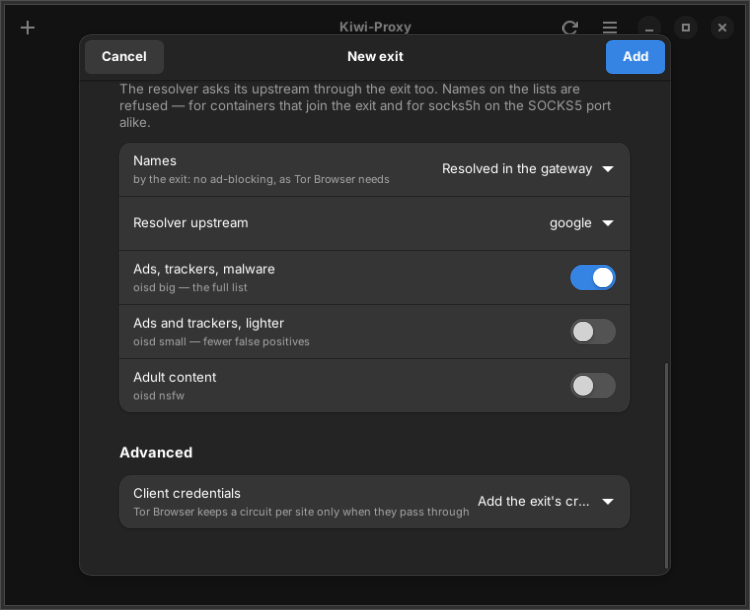

# DNS and ad-blocking

A program that sends its traffic through an exit also has to look up host
names, and those lookups must not leave through your normal connection. This
page explains the two ways an exit resolves names, which DNS services it asks,
and how it refuses names on blocklists, so that ads and trackers are blocked
for everything that uses the exit.

## Two ways to resolve names

Every exit uses one of two DNS modes:

- **resolver** (the default): the gateway runs its own resolver,
  dnscrypt-proxy, at `127.0.0.2:53`. It asks DNS-over-HTTPS (DoH) services, and
  it sends those requests through the exit's upstream. Names are therefore
  resolved from the same place the traffic leaves.
- **remote** (`--dns remote`): the gateway runs no resolver. Every name is
  handed to the upstream, which resolves it itself. Tor needs this, because
  `.onion` names can only be resolved inside the Tor network.

```bash
kiwi-proxy add tor-de --module tor --country de --dns remote
kiwi-proxy set work --dns resolver
```

A [VPN exit](modules.md#vpn-exits) always uses resolver mode.

In resolver mode, the forwarder also resolves a name itself, through the same
resolver, before it connects to the upstream, and it always connects by IPv4.
Everything behind such an exit therefore reaches the world over IPv4, and a
name that has no IPv4 address is refused. In remote mode the names are passed
to the upstream as they are.

## Which DNS services an exit asks

The resolver can ask Quad9, Mullvad, Cloudflare and Google. A new exit asks all
four, and dnscrypt-proxy uses the fastest of them that answers, so one service
that is down costs nothing. `--upstream` chooses fewer:

```bash
kiwi-proxy set work --upstream quad9,mullvad
```

The resolver does not send EDNS Client Subnet, the part of a DNS query that
tells a service where the asker is. The services already see the exit's
location.

## Blocklists

An exit refuses the names on its blocklists, and every name under them: a list
entry `example.com` blocks `example.com` and `ads.example.com`. These lists are
available:

| List | What it blocks |
|---|---|
| `oisd-big` | oisd's big list of ad and tracker domains. This is the default. |
| `oisd-small` | oisd's small list of ad and tracker domains. |
| `oisd-nsfw` | oisd's list of adult sites. |

```bash
kiwi-proxy set work --blocklist oisd-small --blocklist oisd-nsfw
kiwi-proxy set tor-de --no-blocklist
```

The block applies wherever a name shows up, in both DNS modes:

| Who uses the exit | How the name is refused |
|---|---|
| A container that joined the gateway and asks its resolver | The resolver answers REFUSED. |
| A program on the host port with `socks5h://`, or any program on an exit in remote mode | The forwarder refuses the connection to that name. |
| An exit on a kiwi-server machine | The forwarder refuses it; see [On a kiwi-server machine](kiwi-server.md#ad-blocking-on-a-server). |

A program that uses plain `socks5://` resolves names on the host, outside the
exit, and connects by address. Neither the exit nor its blocklists see those
names, so use `socks5h://`.

The lists are downloaded once a day by the `kiwi-proxy-blocklists.timer`
systemd user unit, or by hand with `kiwi-proxy dns update`. Running gateways
use the new lists without a restart. `kiwi-proxy dns sync` downloads the list of
DoH resolvers again.

## Preferences for new exits

`kiwi-proxy prefs` shows and sets what a new exit starts with. Existing exits
keep their own settings; change those with `kiwi-proxy set`.

```bash
kiwi-proxy prefs --upstream quad9,mullvad
kiwi-proxy prefs --blocklist oisd-small
kiwi-proxy prefs --no-blocklist
```

In the app, the same choices are under **Preferences → DNS**, and each exit's
own settings are in its editor.



The preferences are kept in `~/.config/kiwi-proxy/prefs.json`.
